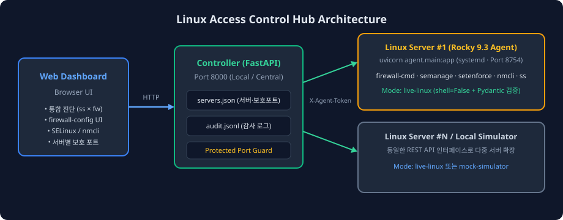

# Linux Access Control Hub

다수의 리눅스 서버에 설치된 **경량 FastAPI Agent**와 중앙 **웹 대시보드(Controller)**를 통해 `firewalld`, `SELinux`, `nmcli`, `ss` 상태를 실시간으로 조회하고 제어하는 웹 기반 관리 콘솔입니다.



---

## 주요 기능

1. **통합 진단 대시보드**
   - `ss -tulnp`(실제 Listen 소켓) × `firewalld`(포트/서비스/Rich Rule) 교차 분석으로 외부 접속 가능 여부를 한눈에 진단
2. **방화벽 제어 (`firewall-config` 웹 구현)**
   - **Configuration 모드**: `Permanent (영구 + Reload)` / `Runtime (임시)` 전환
   - **전체 Zone 관리**: `--list-all-zones` 기반 Zone 선택, 기본 Zone 지정, `Runtime → Permanent`, `Reload`, `Panic Mode`
   - **Services**: 서비스별 허용 포트/프로토콜 표시 및 검색·추가/해제
   - **Ports**: 포트 열기/닫기 및 **서버별 고정 보호 포트(`protected_ports`) 잠금**
   - **Rich Rules**: 출발지 IP/CIDR 기반 `accept` / `drop` / `reject` 규칙 추가·삭제
   - **Masquerading & Port Forwarding**: NAT 토글 및 포트 포워딩 관리
   - **Sources & Interfaces**: Zone별 바인딩 IP/CIDR 및 NIC 관리
   - **ICMP Filter**: 서버가 지원하는 전체 ICMP 타입(`--get-icmptypes`) 검색 및 차단/해제
3. **SELinux 제어**
   - `Enforcing` / `Permissive` 모드 전환, 비표준 포트 레이블 등록(`semanage port`), Boolean 토글(`setsebool -P`)
4. **네트워크 제어 (`nmcli`)**
   - NIC별 IPv4 주소, 게이트웨이, DNS 조회 및 Fixed(Manual)/DHCP 설정 변경
5. **보안 및 감사 로그**
   - `X-Agent-Token` 헤더 인증, Pydantic 정규식 검증 + `shell=False` 실행(명령어 인젝션 차단)
   - 모든 제어 이력을 `audit.jsonl`에 기록

---

## 관련 정리 문서
- [실행 및 운영 명령어 전체 가이드 (Controller, Agent, Docker, 실서버 배포, 테스트)](docs/run-commands.md)
- [리눅스 서버 접근 제어 및 네트워크 관리 정리 (firewalld, SELinux, nmcli, nmtui)](docs/linux-connection-control.md)

---

## 프로젝트 구조
```text
linux-access-control-hub/
├── agent/                  # 리눅스 서버 배포용 FastAPI Agent
│   ├── main.py             # 인증, 보호 포트 가드, REST API 엔드포인트
│   ├── linux_backend.py    # firewall-cmd, semanage, nmcli, ss 실행기
│   ├── mock_backend.py     # Windows/macOS 개발용 인메모리 시뮬레이터
│   ├── schemas.py          # Pydantic 입력 검증 스키마
│   └── agent.service       # systemd 서비스 유닛 파일
├── controller/             # 중앙 웹 대시보드 & 프록시 서버
│   ├── main.py             # 다중 서버 폴링, 프록시, 감사 로그 API
│   ├── store.py            # 서버 목록 및 보호 포트 저장소
│   └── static/             # HTML / CSS / JS 웹 대시보드
├── docs/                   # 아키텍처 이미지 및 리눅스 접근제어 정리 문서
└── tests/                  # pytest 자동화 테스트
```

---

## 사용 방법

### 1. 로컬 테스트 (Windows / 시뮬레이터 모드)
```bash
uv sync --all-extras

# 터미널 1: Mock Agent 실행
uv run uvicorn agent.main:app --host 127.0.0.1 --port 8754

# 터미널 2: Web Dashboard Controller 실행
uv run uvicorn controller.main:app --host 127.0.0.1 --port 8000
```
브라우저에서 `http://127.0.0.1:8000` 접속

### 2. 실서버 배포 (Rocky Linux 9.x / RHEL 9.x)
```bash
# 1) Rocky 서버에 SELinux 관리 도구 및 uv 설치
sudo dnf install -y policycoreutils-python-utils
curl -LsSf https://astral.sh/uv/install.sh | sh

# 2) 프로젝트 파일 전송 후 배포 스크립트 실행 (전용 .venv + Python 3.14 자동 구성 및 서비스 시작)
#    (폐쇄망 서버의 경우 로컬에서 deploy/build_bundle.ps1 실행 후 deploy/wheels 포함 전송)
sudo bash /opt/linux-access-control-hub/deploy/deploy_agent.sh

# 3) 방화벽 Agent 포트 허용
sudo firewall-cmd --permanent --add-port=8754/tcp
sudo firewall-cmd --reload
```
웹 대시보드 좌측 **`+ 추가`** 버튼을 눌러 `http://<서버IP>:8754`과 설정한 토큰(`agent.service` 내 `AGENT_TOKEN`)을 등록하면 즉시 연결됩니다.

### 3. 테스트 실행
```bash
uv run pytest -v
```
